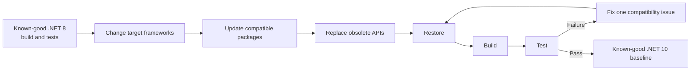

## Exercise 02.01 - Upgrade .NET 8 To .NET 10

**Module:** 02 - Modernize And Migrate
**Associated prompt:** [3.01-upgrade-dotnet-from-8-to-10.prompt.md](../.github/prompts/3.01-upgrade-dotnet-from-8-to-10.prompt.md)

### Learning Objectives

* Upgrade target frameworks across a multi-project solution.
* Update NuGet packages, including moving deprecated test packages to
  supported versions such as xUnit v3.
* Resolve upgrade-time build errors and obsolete API usage.
* Validate an upgrade with a full restore, build, and test pass.

### Overview Of The Prompt

The `3.01` prompt drives a framework upgrade of the active calculator
workspace from `net8.0` to `net10.0`. It covers project file changes, package
version bumps, deprecation cleanup (for example, replacing obsolete
Testcontainers constructors), and post-upgrade validation so the solution
lands on the new framework with a green test suite.

The Dev Container installs SDKs 8 and 10 side by side. Initial setup pins
SDK 8 inside the generated workspace and uses `calculator.sln`. This exercise
is the first point where that SDK pin and project targets change to .NET 10.
Use the GitHub Copilot upgrade extension (`ms-dotnettools.upgrade-agent`),
the successor to App Modernization, rather than silently substituting a
manual upgrade.



An upgrade is a validated transition between two known-good states, not just a
project-file edit. Restore, build, and test each expose a different failure class.

### Steps

1. Complete through
  [Exercise 01.04 - Testing Strategy](01.04-testing-strategy.md) so a working,
  tested solution exists to upgrade. Exercise 01.05 is an optional
  consolidated walkthrough, not a prerequisite.
2. From inside `src/workspace/calculator-xunit-testing/`, record the .NET 8
   baseline with `dotnet --version` and `dotnet test calculator.sln`.
   Follow prompt `3.01` to change the workspace-local `global.json` to an
   installed SDK 10 version. The Dev Container already supplies both SDKs;
   no image change or rebuild is needed. Install SDK 10 locally if missing.
   Enable GitHub Copilot upgrade and select its **Upgrade** agent or `@upgrade`.
   In Copilot Chat, run `/3.01-upgrade-dotnet-from-8-to-10`.
3. Review project file and package reference diffs carefully.
4. Follow the prompt to migrate `.sln` to `.slnx` using SDK 10, then validate
   the upgrade:

   ```bash
   dotnet restore src/workspace/calculator-xunit-testing/calculator.slnx
   dotnet build src/workspace/calculator-xunit-testing/calculator.slnx --no-restore
   dotnet test src/workspace/calculator-xunit-testing/calculator.slnx --no-build
   ```

### Success Criteria

* Both projects target `net10.0` and build without warnings about deprecated
  packages.
* SDK 10 is selected, the solution uses `.slnx`, and the upgrade was performed
  through the extension or an explicitly agreed fallback.
* All tests pass after the upgrade.

### Next Exercise

Continue with [Exercise 02.02 - Refactor To A Blazor Web App](02.02-refactor-to-blazor.md).
